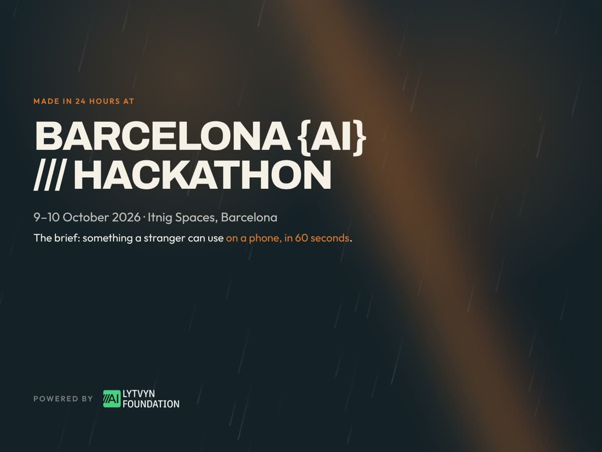

# **Flood prevention for Barcelona.**

Knowing where the water will go, before the next rain.



Built at the [Barcelona AI Hackathon](https://befitting-touch-ead.notion.site/Barcelona-AI-Hackathon-20623b21c94c80a68205fcc546d6bd0c), 10 October 2026. The live tool is [next-rain-barcelona.netlify.app](https://next-rain-barcelona.netlify.app/).

On Saturday 3 October a weather station in Barcelona recorded **more than 190 mm** of rain in a single day, about a third of a normal year’s rain. Within minutes, streets became rivers. Cars were swept away. Some people were trapped.

The aim is one tap from the city’s flood alert. You see which streets near you are flooding, and how to get away from the water.


|                   |                                                                                                     |
| ----------------- | --------------------------------------------------------------------------------------------------- |
| **On the map**    | Coloured streets for that day, a ranked “where to act first” list, and the ground under each place. |
| **For residents** | `/citizen` — “Is my street at risk?”, in plain words, with what to do before the next storm.        |
| **Languages**     | Catalan, Spanish, and English.                                                                      |


Barcelona will see storms like this again. Next time, the map already knows where the floods will happen, and what to fix.

## How the map is made

The water on the map comes from **physics**, not from a guess or AI. A grid sits over Barcelona like a chessboard of small squares. For every square the model calculates five things:

- **Depth** — how deep the water gets
- **Speed** — how fast it moves
- **Direction** — which way it flows
- **Arrival** — when it gets there
- **Duration** — how long it stays

Depth and speed together say whether a street is safe or dangerous. Gravity pulls the water downhill along a laser map of the city. Friction from the street slows it: rough ground and buildings hold the flow back, smooth asphalt lets it run. After every step the model checks that water in, minus water out, equals water stored. If the numbers do not add up, the map cannot be trusted.

A gradient-boosting classifier, trained on our own dataset, gives the margin of error. Only results inside that margin are shown. If the number is too low, nothing ships.

## How we built it

Five agents, each with one job.


|                     |                             |                                                            |
| ------------------- | --------------------------- | ---------------------------------------------------------- |
| **01 · Data**       | Found and checked the data. | Rain, terrain, land use. Every source verified before use. |
| **02 · Physics**    | Wrote the physics.          | The flow equations that move water across the city.        |
| **03 · Auditor**    | Tested the maths.           | Independent. Could stop the run if something was wrong.    |
| **04 · Backend**    | Built the backend.          | Runs the model and serves the map.                         |
| **05 · Map tester** | Tested the map data.        | Every layer checked against the ground.                    |


## Run

Node 20 or newer. If you use [nvm](https://github.com/nvm-sh/nvm), `nvm use` picks it up.

```bash
npm install
npm run dev
```

The production build is the demo:

```bash
npm run build
npm run preview
```

Data checks:

```bash
npm run qa
npm run qa:urls
```

Canonical data lives in `data/`. The npm scripts copy it to `public/data`, so the static build serves the same paths. A fresh checkout builds without the flood backend.

## Demo

On a phone, from the [live demo](https://next-rain-barcelona.netlify.app/) or the production build. About 60 seconds.

1. Open the map. Saturday 3 October, **190.8 mm** at el Raval. The coloured streets inside the dashed **Simulated area** are the model’s water depth for that day.
2. Tap **See list**. “Where to act first” ranks the spots. Tap **#1, La Rambla**: the sheet drops and the popup says why water collects there.
3. Tap the round house button, or open `/citizen`. Same storm, asked the way a resident would: “Is my street at risk?”
4. Tap **La Rambla**: “Water reached above the knee near here”, with what to do before the next storm.

The round rain button opens the storm week: station totals, Bluesky chatter, and Wikipedia attention. Share any card with `?zone=<id>`, for example `?zone=proof-torre-baro-2026-10`.

## Simulation chunks

The flood model runs one area at a time. Each run is a chunk under `data/flood/<run-id>/`, and `data/flood/index.json` lists them with their bounding boxes.

The app loads the index, then only the chunks that touch the map view — nearest first, at most 6. Dashed outlines show every chunk, loaded or not. So far only the Urgell/Raval box has been run. The rest of the metro area needs the backend inputs (DEM, land cover, XEMA rain), which are not in this repo.

To add an area:

```bash
RUN_ID=<run-id> npm run sync:flood
```

That pulls the run, slims the street files, and rebuilds the index. Slimming hoists per-segment boilerplate to the collection and rounds coordinates to 6 decimals — about 3× smaller, **2.6 MB → 0.8 MB** per day. `npm run slim:flood` redoes that on the data already in the repo.

Run layout, index fields, and how to switch a run off without touching code are in `[data/flood/README.md](data/flood/README.md)`.

Under the chunks sits a dim city-wide terrain layer (`data/terrain-pooling.png`: lidar hollows and flat lowland, a reading of the ground, not the flood model). Delete `data/terrain-pooling.json` to turn it off.

Two things fill in only when you generate them locally:

- `npm run pulse` and `npm run attention` add the Bluesky and Wikipedia blocks to the Weather panel. Both need network.
- The build report under “How the model ran” needs the backend to write `backend/outputs/inputs/bcn_30m.report.json`. Without it the panel says so, and the rest of the app is unaffected.


## Offline

The production build registers a service worker. After one online load, a reload can use the cached app, GeoJSON, and basemap tiles already seen. Flood chunks are cached as they are viewed, not on install, so a chunk or tile that was never opened is not in the cache.

## Sources

Layer links are in the in-app About panel and in `data/sources.json`. Geometries are simplified traces and neighbourhood outlines for a briefing. PDISBA plan PDFs are cited, not republished.

## Stack

[Vite](https://vite.dev/), [React](https://react.dev/), [MapLibre GL](https://maplibre.org/), [OpenFreeMap](https://openfreemap.org/) Positron basemap. No weather API in the app. The map is a static site. The flood model is a separate Python backend that produces the chunks the map shows.